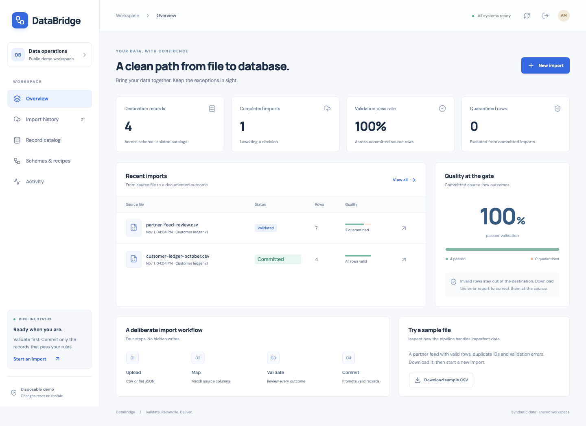

# DataBridge

[](https://databridge-demo.onrender.com/)

**[Open the live demo](https://databridge-demo.onrender.com/)** · Select **Try the demo**. No account or password needed. The free server may take about a minute to wake; shared synthetic data resets on restart.

**A data-quality and ingestion workspace that turns imperfect source files into traceable, canonical records.**

DataBridge combines a **Python / FastAPI** backend, a **SQL-backed ingestion engine** and a **React / TypeScript** interface. It separates source ingestion, deterministic validation and transactional promotion so that a successful upload is never confused with a successful import.

The implemented destination is a customer ledger: an external identifier, customer name, email, USD amount, record date and country code. The column mapping is configurable; the destination schema and validation rules are explicit.



## What the application does

- Ingests UTF-8 CSV or a JSON array of flat objects, preserving source headers and row values.
- Maps source columns to six canonical fields through an interactive review step.
- Normalizes whitespace, email casing and two-letter country codes; validates identifiers, dates, required values and decimal amounts.
- Classifies every source row as **insert**, **update**, **skip** or **reject** before writing destination records.
- Skips identical duplicates while quarantining conflicting duplicates within a file.
- Supports **insert-only** protection or explicit **upsert** of changed records.
- Commits accepted rows atomically while keeping invalid rows in the validation report.
- Makes commit retries safe: replaying a committed run does not repeat its writes or audit events.
- Rejects stale validation snapshots when another import changes the destination.
- Preserves the original row decisions and normalized values even after a later upsert changes the destination record.
- Exports a spreadsheet-safe error report and the normalized destination catalog as CSV.
- Connects each destination record to its most recent source import and exposes an event timeline.
- Provides the same ingestion engine through the web API and a command-line interface.

## Architecture

```text
CSV / JSON file
      |
      v
Bounded parser -----> immutable source snapshot
      |                       |
      v                       v
Column mapping + policy + destination revision
      |
      v
Deterministic validation -----> row decisions + error report
      |
      v
Freshness check + atomic transaction
      |
      +----> canonical records
      +----> committed run status
      +----> destination revision
      +----> audit event
```

| Layer | Implementation | Responsibility |
| --- | --- | --- |
| User interface | React, TypeScript, Vite, Lucide | Upload, mapping, validation review, catalog and history |
| HTTP boundary | Python 3.12, FastAPI, Pydantic | Typed request contracts, sessions, origin and CSRF checks |
| Ingestion engine | Python standard library | CSV/JSON parsing, Decimal amounts, ISO dates, duplicate decisions |
| Relational storage | SQLite, parameterized SQL | Constraints, transactions, source/run provenance and revision checks |
| Browser verification | Playwright / Chromium | Complete upload-to-commit scenario and mobile layout check |
| Automated checks | pytest, FastAPI TestClient | Domain invariants, rollback, concurrency, storage and API behavior |
| Delivery | Docker, GitHub Actions | Reproducible dependency installation, checks and single-service hosting |

## Run locally

Requirements: **Python 3.12+**, **Node.js 24** and npm.

```sh
python3 -m venv .venv
.venv/bin/pip install -r requirements.lock
npm ci --prefix frontend
npm run build --prefix frontend
PUBLIC_DEMO=true .venv/bin/python -m uvicorn backend.app:create_app --factory --host 127.0.0.1 --port 3300
```

Open **http://127.0.0.1:3300** and select **Try the demo**. The workspace starts with synthetic customer records, one committed import and a second file awaiting review.

### A complete walkthrough

1. Select **Download sample CSV**, then **New import**.
2. Choose the downloaded file. Matching canonical headers are preselected; other files require explicit mappings.
3. Select **Validate file**. Review inserts, skipped duplicates and quarantined errors.
4. Download the **Error report** if you want to correct the rejected rows.
5. Select **Commit valid rows**. The valid records appear in **Record catalog**; rejected rows are excluded.
6. Open a record's **View import** link to inspect its provenance.
7. Re-upload the same file to see unchanged records skipped. Use **upsert** only when you intend to replace changed values.

## Validation contract

| Field | Rule |
| --- | --- |
| `external_id` | Required; 1–80 ASCII letters, digits, dots, underscores or hyphens; destination unique key |
| `name` | Required; whitespace trimmed; at most 120 characters |
| `email` | Required; normalized to lowercase; syntactic address validation; at most 254 characters |
| `amount` | Required USD decimal; nonnegative; at most two fractional digits; maximum 999,999,999.99 |
| `date` | Required calendar date in exact `YYYY-MM-DD` format |
| `country` | Required two-letter alphabetic code, normalized to uppercase |

Country validation checks format, not membership of an ISO country-code list. Email validation checks syntax, not deliverability. Amounts use `Decimal` and are stored as integer cents; this application does not process payments.

A malformed file fails ingestion. A well-formed file with invalid record values proceeds to row validation, where individual rows are quarantined. The source-row number is one-based within the data records, excluding the CSV header.

## Engineering decisions

### An upload must not silently change the destination

The source snapshot and validation report are stored separately from canonical records. Mapping or validating a file changes import metadata only. Promotion happens through an explicit commit operation, and the UI exposes the exact proposed outcomes first.

### Retry safety needs an identity and a transaction boundary

Validation identity includes the source content digest, mapping, conflict policy and destination revision. Equivalent validation requests at the same revision return the same run. Committing an already committed run returns its original result. Record changes, status, revision increment and commit event share one SQL transaction.

The commit test deliberately fails the second record write and verifies that the first record, run status, destination revision and audit event all roll back. Concurrent calls to the same commit are serialized and produce one commit event.

### A correct preview can become outdated

Every validation captures the destination revision. A commit compares that revision inside the transaction and returns a conflict if another import has changed the catalog. **Revalidate** creates an updated report; it does not silently reuse stale decisions.

### Duplicate records have different meanings

An identical record can be skipped safely. A changed destination record requires an explicit upsert policy. Within a single source file, the first valid occurrence takes precedence: later identical occurrences skip; later conflicting occurrences reject. File ordering is part of this contract.

### Diagnostics should preserve evidence

Each report retains raw source values, normalized candidate values and validation reasons. Later updates do not rewrite historical reports. CSV exports escape leading spreadsheet formula markers before values are written to a downloadable file.

## Command-line workflow

Validate without promoting destination records:

```sh
.venv/bin/python -m backend.cli samples/partner-feed.csv --errors /tmp/databridge-errors.csv
```

Import a JSON file with different source headers into a persistent local database:

```sh
.venv/bin/python -m backend.cli samples/vendor-feed.json \
  --mapping samples/vendor-mapping.json \
  --database data/ledger.sqlite \
  --commit
```

Exit codes: `0` = no rejected rows; `2` = validation completed with rejected rows; `1` = ingestion/configuration failure. With `--commit`, valid rows may be committed even when the exit code is `2`. A dry run stores its report in the selected database but does not change destination records. The default in-memory database is discarded when the command exits.

Do not run the CLI against the same database while the web server is running. The supported deployment is one engine process.

## Demo and private storage

The public demo uses **in-memory SQLite**, synthetic records and one-click session entry. All visitors share its data; records and sessions reset on process restart. It does not attach an external database, and it refuses a persistent `DATABASE_PATH` in demo mode. Please use synthetic files in the public workspace.

For a persistent **local, single-operator** workspace:

```sh
PUBLIC_DEMO=false DATABASE_PATH=data/databridge.sqlite \
OPERATOR_PASSWORD='replace-with-a-unique-password-of-16-or-more-characters' \
.venv/bin/python -m uvicorn backend.app:create_app --factory --host 127.0.0.1 --port 3300 --workers 1
```

Set `SEED_DEMO=false` for an empty workspace. Set `COOKIE_SECURE=true` behind hosted HTTPS. `APP_ORIGIN` can declare an allowed frontend origin; Render's service URL is recognized through `RENDER_EXTERNAL_URL`.

Public and private entry create expiring, HTTP-only, SameSite sessions. Interactive writes require the session's CSRF token. Cross-origin writes are rejected, and entry attempts are bounded. Uploads have file, row, column and value limits, with additional workspace source/report storage caps.

## Verification

```sh
.venv/bin/python -m pytest -q
npm run build --prefix frontend
npm run test:e2e --prefix frontend
```

The automated suite covers validation/quarantine, exact monetary storage, malformed files, JSON mapping, duplicate classification, explicit upserts, concurrent retries, stale previews, forced rollback, persistence, provenance, formula-safe error export, session rotation, origin checks and CSRF enforcement. The browser scenario uploads and maps a file, reviews rejected/duplicate rows, commits valid data, opens source history and downloads an error report.

GitHub Actions runs the Python suite, TypeScript build and Chromium scenario. See [verification notes](docs/VERIFICATION.md) for the recorded local result.

## Scope and next steps

This is a focused ingestion application for a defined ledger schema. It is not a general-purpose ETL orchestrator. The current implementation is synchronous, bounded to 5,000 rows / 2 MB per file, single-process and backed by SQLite. It does not claim a PostgreSQL adapter, distributed workers, scheduled ingestion, external API connectors, multi-tenant isolation or measured production throughput.

[Architecture and API](docs/ARCHITECTURE.md) · [Development roadmap](docs/ROADMAP.md) · [GitHub guide](docs/GITHUB_UPLOAD_RU.md) · [CV / LinkedIn wording](docs/PORTFOLIO.md)
